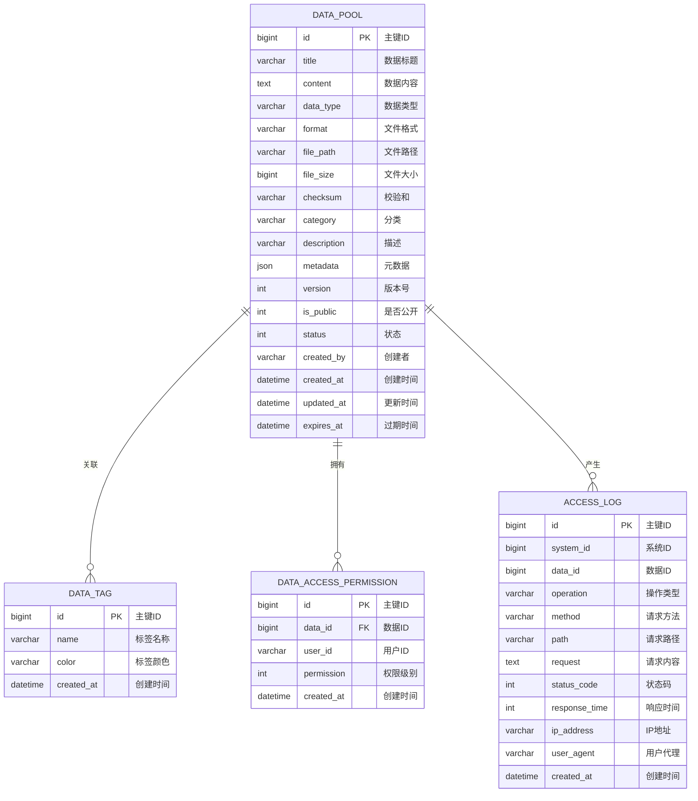

# 数据池系统分类体系文档

## 1. 系统概述

数据池系统是一个集中存储软件产生所有数据的结构化存储系统，具备完善的数据分类机制、高效的存储管理、数据检索、数据备份和数据安全功能。

---

## 2. 数据分类体系

### 2.1 分类维度

| 分类维度 | 说明 | 取值范围 |
|---------|------|---------|
| **数据类型** | 数据的本质类型 | text, structured, image, audio, video, document |
| **来源模块** | 数据产生的业务模块 | chat, feed, character, system, admin |
| **时间戳** | 数据创建时间 | 自动生成 |
| **重要程度** | 数据的重要级别 | low, medium, high, critical |
| **访问权限** | 数据的可见范围 | public, protected, private |
| **状态** | 数据处理状态 | pending, processing, completed, archived, deleted |
| **格式** | 数据文件格式 | json, xml, csv, txt, yaml, pdf, doc, docx, xls, xlsx, jpg, png, gif, mp3, mp4 |

### 2.2 数据类型分类

| 类型 | 说明 | 支持格式 | 存储路径 |
|------|------|---------|---------|
| **text** | 纯文本数据 | txt, md | /datapool/text/{year}/{month}/ |
| **structured** | 结构化数据 | json, xml, csv, yaml | /datapool/structured/{year}/{month}/ |
| **image** | 图像数据 | jpg, png, gif, webp | /datapool/image/{year}/{month}/ |
| **audio** | 音频数据 | mp3, wav, ogg | /datapool/audio/{year}/{month}/ |
| **video** | 视频数据 | mp4, avi, mov | /datapool/video/{year}/{month}/ |
| **document** | 文档数据 | pdf, doc, docx, xls, xlsx | /datapool/document/{year}/{month}/ |

### 2.3 来源模块分类

| 模块 | 说明 | 标识 |
|------|------|------|
| **chat** | 聊天模块产生的数据 | chat |
| **feed** | AI投喂模块产生的数据 | feed |
| **character** | 角色管理模块产生的数据 | character |
| **system** | 系统模块产生的数据 | system |
| **admin** | 管理后台产生的数据 | admin |

### 2.4 重要程度分类

| 级别 | 说明 | 存储策略 |
|------|------|---------|
| **critical** | 关键数据 | 实时备份，保留期限永久 |
| **high** | 重要数据 | 每日备份，保留期限5年 |
| **medium** | 中等重要 | 每周备份，保留期限2年 |
| **low** | 一般数据 | 每月备份，保留期限1年 |

---

## 3. 存储路径规范

### 3.1 文件存储结构

```
datapool/
├── text/
│   ├── {year}/
│   │   └── {month}/
│   │       └── {uuid}.txt
├── structured/
│   ├── {year}/
│   │   └── {month}/
│   │       └── {uuid}.json
├── image/
│   ├── {year}/
│   │   └── {month}/
│   │       └── {uuid}.jpg
├── audio/
│   ├── {year}/
│   │   └── {month}/
│   │       └── {uuid}.mp3
├── video/
│   ├── {year}/
│   │   └── {month}/
│   │       └── {uuid}.mp4
├── document/
│   ├── {year}/
│   │   └── {month}/
│   │       └── {uuid}.pdf
└── backup/
    └── {date}/
        └── datapool_backup_{date}.zip
```

### 3.2 文件命名规则

```
{uuid}_{timestamp}_{checksum}.{extension}
```

- **uuid**: 32位UUID，唯一标识
- **timestamp**: 创建时间戳（毫秒）
- **checksum**: SHA-256校验和前8位
- **extension**: 文件扩展名

---

## 4. 访问权限管理

### 4.1 权限级别

| 权限级别 | 说明 | 访问范围 |
|---------|------|---------|
| **public** | 公开数据 | 所有用户可访问 |
| **protected** | 受保护数据 | 授权用户可访问 |
| **private** | 私有数据 | 仅创建者和管理员可访问 |

### 4.2 角色权限矩阵

| 角色 | 查看公共数据 | 查看私有数据 | 创建数据 | 修改数据 | 删除数据 | 管理权限 |
|------|------------|------------|---------|---------|---------|---------|
| 匿名用户 | ✓ | ✗ | ✗ | ✗ | ✗ | ✗ |
| 普通用户 | ✓ | 仅自己 | ✓ | 仅自己 | 仅自己 | ✗ |
| 管理员 | ✓ | ✓ | ✓ | ✓ | ✓ | ✓ |

---

## 5. 数据生命周期管理

### 5.1 生命周期阶段

| 阶段 | 状态 | 说明 | 持续时间 |
|------|------|------|---------|
| **创建** | pending | 数据已创建，待处理 | 0-24小时 |
| **处理** | processing | 数据正在处理中 | 根据数据大小 |
| **完成** | completed | 数据处理完成，可使用 | 主要状态 |
| **归档** | archived | 数据归档存储 | 超过保留期限 |
| **删除** | deleted | 数据已删除（软删除） | 可恢复期30天 |

### 5.2 生命周期策略

| 数据类型 | 创建阶段 | 处理阶段 | 完成阶段 | 归档触发 | 删除触发 |
|---------|---------|---------|---------|---------|---------|
| critical | 即时 | 优先 | 永久 | 永不 | 永不（除非手动） |
| high | 即时 | 高优先 | 5年 | 超过5年 | 归档后1年 |
| medium | 即时 | 中优先 | 2年 | 超过2年 | 归档后6个月 |
| low | 延迟 | 低优先 | 1年 | 超过1年 | 归档后3个月 |

---

## 6. 数据备份策略

### 6.1 备份类型

| 备份类型 | 频率 | 保留期限 | 存储位置 |
|---------|------|---------|---------|
| **增量备份** | 每小时 | 7天 | 本地 + 云端 |
| **每日备份** | 每天凌晨2点 | 30天 | 本地 + 云端 |
| **每周备份** | 每周日凌晨2点 | 3个月 | 云端 |
| **每月备份** | 每月1日凌晨2点 | 1年 | 云端冷存储 |

### 6.2 备份流程

1. **数据一致性检查**: 备份前验证数据完整性
2. **增量差异计算**: 计算与上次备份的差异
3. **加密存储**: 使用AES-256加密备份文件
4. **多副本存储**: 本地一份，云端两份
5. **备份验证**: 备份完成后验证完整性

---

## 7. 数据安全策略

### 7.1 数据加密

| 加密层级 | 加密方式 | 说明 |
|---------|---------|------|
| **传输加密** | TLS 1.3 | 所有API请求强制HTTPS |
| **存储加密** | AES-256 | 文件内容加密存储 |
| **数据库加密** | AES-128 | 敏感字段加密 |
| **备份加密** | AES-256 | 备份文件加密 |

### 7.2 访问控制

- **API密钥认证**: 系统级访问使用API Key + Secret Key
- **JWT令牌**: 用户级访问使用JWT令牌
- **IP白名单**: 限制API访问来源
- **请求频率限制**: 防止恶意请求

### 7.3 审计日志

所有数据操作记录审计日志，包括：
- 操作时间
- 操作类型（创建、读取、更新、删除）
- 操作者信息
- 操作对象
- 操作结果
- 客户端IP

---

## 8. 数据检索机制

### 8.1 检索类型

| 检索方式 | 说明 | 适用场景 |
|---------|------|---------|
| **关键词搜索** | 全文检索标题、内容、描述 | 模糊匹配 |
| **分类筛选** | 按数据类型、分类、状态筛选 | 精确匹配 |
| **时间范围** | 按创建时间范围筛选 | 时间序列查询 |
| **高级查询** | 多条件组合查询 | 复杂查询场景 |

### 8.2 检索优化

- **索引优化**: 为常用查询字段创建索引
- **缓存策略**: 热门查询结果缓存
- **分页处理**: 大结果集分页返回
- **异步查询**: 复杂查询异步处理

---

## 9. API接口清单

### 9.1 数据管理接口

| 接口 | 方法 | 路径 | 说明 |
|------|------|------|------|
| 添加数据 | POST | /api/datapool/add | 添加数据到数据池 |
| 批量添加 | POST | /api/datapool/batch | 批量添加数据 |
| 文件导入 | POST | /api/datapool/import | 从文件导入数据 |
| 查询数据 | GET | /api/datapool/query | 分页查询数据 |
| 获取详情 | GET | /api/datapool/{id} | 获取数据详情 |
| 更新数据 | PUT | /api/datapool/{id} | 更新数据 |
| 删除数据 | DELETE | /api/datapool/{id} | 删除数据 |
| 搜索数据 | GET | /api/datapool/search | 关键词搜索 |

### 9.2 分类管理接口

| 接口 | 方法 | 路径 | 说明 |
|------|------|------|------|
| 按分类查询 | GET | /api/datapool/category/{category} | 获取指定分类数据 |
| 按类型查询 | GET | /api/datapool/type/{type} | 获取指定类型数据 |
| 获取分类列表 | GET | /api/datapool/categories | 获取所有分类 |
| 获取类型列表 | GET | /api/datapool/types | 获取所有类型 |

### 9.3 备份管理接口

| 接口 | 方法 | 路径 | 说明 |
|------|------|------|------|
| 执行备份 | POST | /api/datapool/backup | 手动执行备份 |
| 获取备份列表 | GET | /api/datapool/backups | 获取备份记录 |
| 恢复数据 | POST | /api/datapool/restore/{backupId} | 从备份恢复 |

### 9.4 权限管理接口

| 接口 | 方法 | 路径 | 说明 |
|------|------|------|------|
| 设置权限 | PUT | /api/datapool/{id}/permission | 设置数据权限 |
| 获取权限 | GET | /api/datapool/{id}/permission | 获取数据权限 |
| 共享数据 | POST | /api/datapool/{id}/share | 共享数据给用户 |

---

## 10. 监控与告警

### 10.1 监控指标

| 指标 | 说明 | 告警阈值 |
|------|------|---------|
| 存储空间使用率 | 数据池存储使用百分比 | >90% |
| 数据量增长率 | 每日数据增长百分比 | >50% |
| API请求频率 | 每分钟API请求数 | >1000 |
| 备份成功率 | 备份任务成功率 | <95% |
| 数据完整性 | 校验和验证失败率 | >1% |

### 10.2 告警方式

- **系统日志**: 记录所有告警信息
- **邮件通知**: 发送告警邮件给管理员
- **实时通知**: 推送告警到管理后台

---

## 附录：数据池ER图



---

**文档版本**: v1.0  
**创建日期**: 2024年1月  
**适用系统**: AI Chat Graduation Project  
**维护者**: 开发团队